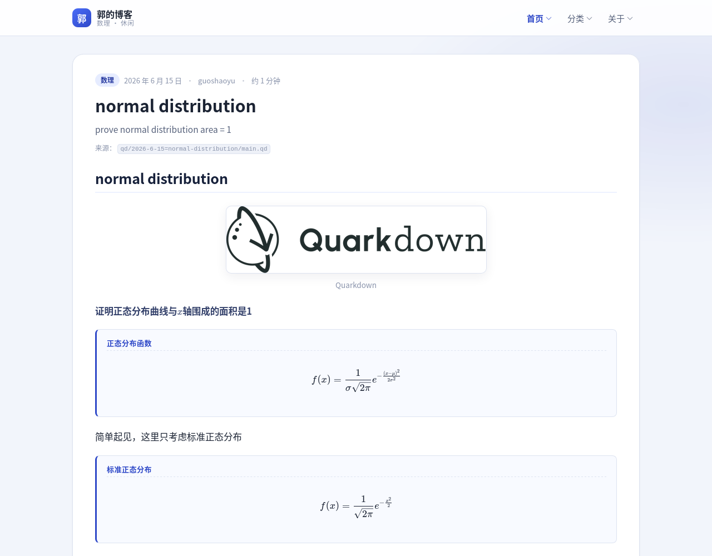
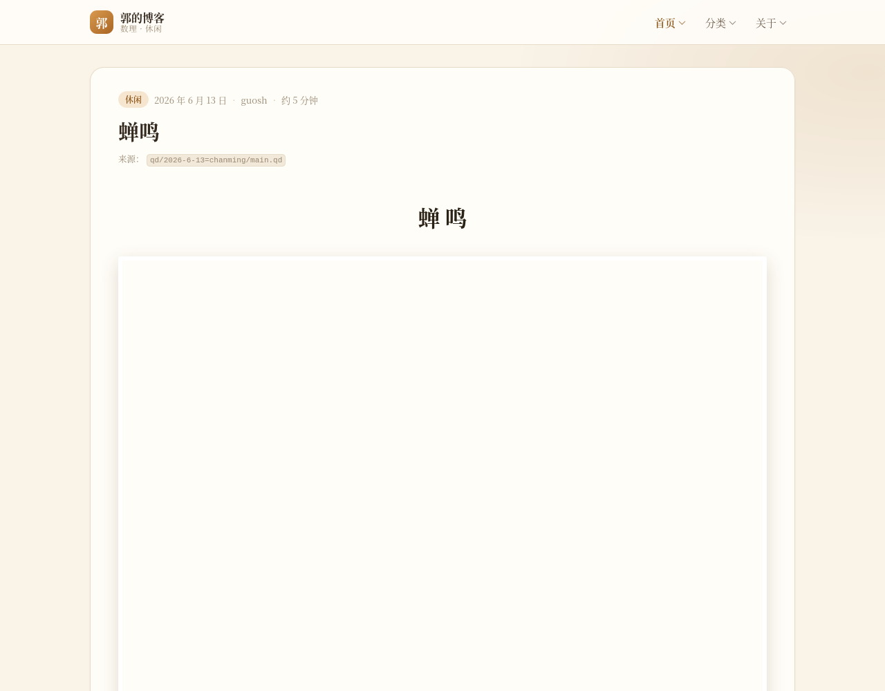

# 郭的博客 · PHP 版

用最基本的 **HTML + PHP + 一点点 JS** 重写的博客站，内容来自仓库里的 `qd/` 目录
（之前的 Quarkdown 站点），评论用 **SQLite + PHP**。

- 两类内容：**数理**（推导、证明）与 **休闲**（小说、随笔）
- 两类内容各自一份**独立样式表**：`assets/css/math.css` / `assets/css/leisure.css`
- 每页都有**同一个导航栏**（首页 / 分类 / 关于），点一下向下展开子菜单
- 评论系统：一张表、一个表单、一次 POST
- **提交新博客**入口：`submit.php`，表单校验、预览、落盘全部由 PHP 完成
- 公式用 **KaTeX 0.16.44** 渲染，资源全部在本地，不依赖 CDN

| 首页 | 数理（`math.css`） | 休闲（`leisure.css`） |
|---|---|---|
|  |  |  |

---

## 1. 跑起来

```bash
cd PHP
bin/serve.sh            # 默认 http://127.0.0.1:8080
bin/serve.sh 9000       # 换端口
```

`bin/serve.sh` 会做一件本机特有的事：这台机器的 PHP 8.4 没有编译
`pdo_sqlite` / `sqlite3`（也没有 `mbstring`），脚本会自动用
`-d extension=vendor/php-ext/...` 把随站点附带的扩展加载进来，不需要 root。

如果想让 Apache / Nginx 来跑，把站点根目录指到 `PHP/` 即可；此时需要自己
确保 PHP 有 `pdo_sqlite` 或 `sqlite3` 扩展（否则评论区会显示一条友好的提示，
其余页面照常工作）。

初始化数据库（可选，首次访问会自动建表）：

```bash
php bin/init-db.php
```

### 公式自检

```bash
bin/check-math.sh
```

把全站公式抽出来，用本地 KaTeX 全部试渲染一遍，任何一条渲染失败都会报错退出。

---

## 2. 目录结构

```
PHP/
├── index.php            首页（最新 + 全部，支持 ?c=math|leisure 过滤）
├── category.php         分类总览 / 单分类（?c=math|leisure）
├── post.php             文章正文 + 评论
├── about.php            关于（含站点结构、数据库说明）
├── submit.php           提交新博客（校验 / 预览 / 发布，纯 PHP）
├── comment.php          评论写入（POST → 302，防重复提交）
├── media.php            文章图片出口（校验路径与扩展名）
│
├── lib/
│   ├── compat.php       本机没有 mbstring，用 preg_* 补 5 个 mb_* 函数
│   ├── Config.php       全站路径、分类名、样式表映射
│   ├── Database.php     SQLite 访问层（PDO 优先，SQLite3 兜底）+ 建表
│   ├── CommentRepo.php  评论读写
│   ├── Quarkdown.php    .qd 源文件 → HTML 的解析器（本项目的核心）
│   ├── Post.php         文章值对象：元信息、渲染、摘要、阅读时间
│   ├── PostRepo.php     扫描 qd/ 与 data/posts/，合并排序、判分类
│   └── View.php         极简模板渲染
│
├── templates/
│   ├── layout.php       整页骨架（<head> + 导航 + 页脚）
│   ├── nav.php          导航栏（三个 <details>，零 JS）
│   ├── post-card.php    文章卡片
│   └── comments.php     评论区（列表 + 表单）
│
├── assets/
│   ├── css/base.css     公共样式（布局 / 导航 / 表单 / 评论）
│   ├── css/math.css     数理专用（冷色、学术）
│   ├── css/leisure.css  休闲专用（暖色纸张、衬线、首字下沉）
│   ├── js/katex-render.js  全站唯一的一段 JS
│   └── katex/           本地 KaTeX 0.16.44（含 20 个字体文件）
│
├── data/
│   ├── categories.php   分类规则（覆盖 / 关键词 / 改标题 / 隐藏）
│   ├── posts/           网页提交的新博客，<slug>/main.qd + image/
│   ├── cache/           正文解析缓存、公式自检结果
│   ├── sessions/        PHP session（避免依赖系统目录权限）
│   └── blog.sqlite      评论数据库（首次访问自动创建）
│
├── vendor/php-ext/      随站点附带的 pdo_sqlite / sqlite3 扩展
└── bin/
    ├── serve.sh         启动开发服务器（自动加载扩展）
    ├── init-db.php      初始化数据库
    ├── extract-math.php 导出全站公式
    ├── check-katex.js   用 KaTeX 试渲染
    └── check-math.sh    上两步的组合
```

---

## 3. 内容从哪来

文章有两个来源，都会被 `PostRepo` 扫描并合并：

| 来源 | 路径 | 说明 |
|---|---|---|
| 旧博客 | `../qd/<目录>/main.qd` | 原有内容，一个目录一篇 |
| 网页提交 | `data/posts/<slug>/main.qd` | `submit.php` 写入，目录约定与上面一致 |

图片不直接暴露磁盘路径，统一走：

```
media.php?p=<文章 slug>&f=image/fig1.png
```

`media.php` 会校验文章存在、扩展名在白名单内、真实路径没有跳出文章目录。

### 标题与日期怎么定

- **日期**：目录名 `2026-6-15=xxx` 的前缀；没有前缀就用文件修改时间。
- **标题**：按顺序取第一个「像样的」候选 ——
  正文里 1~3 级标题 → `.docname` → 目录名去掉日期。
  纯数字、`practice3` 这类内部标记会被跳过。
- **分类**：`.doccategory` → `data/categories.php` 的 `overrides` →
  关键词 → 默认数理。要手工调整就改 `data/categories.php`。

---

## 4. 正文语法（Quarkdown 子集）

`lib/Quarkdown.php` 实现了 `qd/` 实际用到的语法，够写博客了：

| 写法 | 效果 |
|---|---|
| `# 标题` … `###### 标题` | 各级标题（`#!` 也认，`!` 忽略） |
| 空行分段 | 段落 |
| `- 条目` / `* 条目` | 无序列表，支持缩进续行 |
| `$ ... $` | 行内公式 |
| 单独一行的 `$ ... $` | 行间公式 |
| `$$$ ... $$$` | 行间公式块（支持 `\begin{cases}` 等） |
| `!(50%)[说明](image/a.png)` | 图片，带宽度与图注 |
| `` | 图片，80% 宽 |
| `.box {标题} type:{tip}` + 缩进正文 | 提示框（tip / note / warning / important） |
| `.eq {标题}{公式}`、`.eq {公式}` | 公式卡片 / 居中公式 |
| `.center`、`.row`、`.column`、`.container` | 排版容器 |
| `.pagebreak` | 分页符（休闲主题下渲染成一枚 ❦） |
| `.tableofcontents` | 目录 |
| `.texmacro {\bvec} {\overrightarrow{#1}}` | 自定义 TeX 宏，会传给 KaTeX |
| `.docauthors` + 列表 | 作者（只做元信息，不渲染） |
| `<!-- ... -->`、`<!--- ... --->` | 注释，整段丢弃 |
| `**粗体**`、`*斜体*`、`` `代码` ``、`[文字](链接)` | 行内格式 |

解析结果按「文件 mtime + 大小 + 解析器版本 + 站点根路径」缓存到
`data/cache/`，改了源文件会自动失效。

---

## 5. 为什么还有 JS

只有一件事必须用 JS：**KaTeX 只有 JavaScript 实现，没有 PHP 版本**。

所以：

- 导航栏用原生 `<details>` / `<summary>`，点一下向下展开，**零 JS**；
- 评论、提交、预览、分页、图片全部在 PHP 里完成；
- `assets/js/katex-render.js` 只做一件事：把 PHP 输出的
  `<div class="qd-math" data-tex="...">` 交给 `katex.render()`。

公式元素的原始 TeX 会以 `.qd-tex-src` 的形式留在 DOM 里作为回退：
万一 KaTeX 没加载成功，页面上显示的仍然是可读的公式源码，内容不会丢。

### 解析器做的两个额外处理

1. **自定义宏**：源文件里的 `.texmacro` 会被收集起来，通过
   `window.QD_KATEX_MACROS` 传给 KaTeX，所以 `\bvec{F_1P}` 能正常渲染。
2. **中文自动包 `\text{}`**：作者有时把中文直接写在数学模式里
   （比如 `... = 0 ,即\bvec{u} \perp ...`）。解析器会把裸露的中文
   包成 `\text{即}`，已经写在 `\text{}` 里的保持原样。
   处理完全站 315 条公式 **0 失败 0 警告**。

---

## 6. 评论与数据库

只有一张表，`lib/Database.php` 首次访问时自动建：

```sql
CREATE TABLE comments (
    id         INTEGER PRIMARY KEY AUTOINCREMENT,
    post_slug  TEXT NOT NULL,
    author     TEXT NOT NULL,
    body       TEXT NOT NULL,
    created_at TEXT NOT NULL,
    ip_hash    TEXT NOT NULL DEFAULT ''
);
CREATE INDEX idx_comments_post ON comments (post_slug, id);
```

- 提交走 `comment.php`：校验 CSRF → 校验长度 → 写库 → 302 回文章页（PRG 模式）；
- 蜜罐字段 `url` 被填了就当成垃圾评论丢掉；
- 输出一律 `htmlspecialchars`，`ip_hash` 只存哈希；
- 数据库不可用时，评论区显示提示，其余页面不受影响。

---

## 7. 提交新博客

打开 `/submit.php`：

1. 填标题、选分类（分类决定用哪份 CSS）、填作者和摘要；
2. 正文写 Quarkdown（表单下方有语法提示）；
3. 可以多选上传图片，会存到 `data/posts/<slug>/image/`；
4. 点「预览」先在同一个页面里用 PHP 渲染一遍，确认无误再点「发布」。

发布后写入 `data/posts/<slug>/main.qd`，格式与 `qd/` 里的旧文件完全一致，
所以能被同一套解析器读取，也会出现在首页与分类页里。

---

## 8. 本机环境说明

这台机器的 PHP 8.4.26 缺少几个常用扩展，项目里做了对应处理：

| 缺什么 | 处理方式 |
|---|---|
| `pdo_sqlite` / `sqlite3` | `vendor/php-ext/` 附带扩展，`bin/serve.sh` 用 `-d extension=` 加载 |
| `mbstring` | `lib/compat.php` 用 `preg_*` 补上 `mb_strlen` 等 5 个函数 |

`vendor/php-ext/` 里的扩展来自 Debian 的 `php8.4-sqlite3` 包，
重新获取的方式：

```bash
apt-get download php8.4-sqlite3
dpkg-deb -x php8.4-sqlite3_*.deb vendor/php-ext/
```

只要系统 PHP 自带 `pdo_sqlite`（大多数发行版默认都有），
这些兼容层会自动让路，脚本也不会重复加载。
