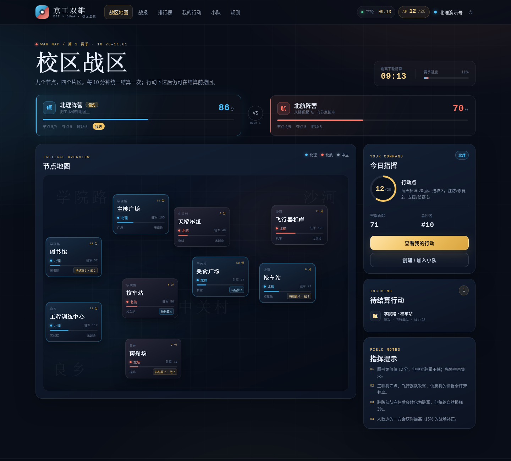
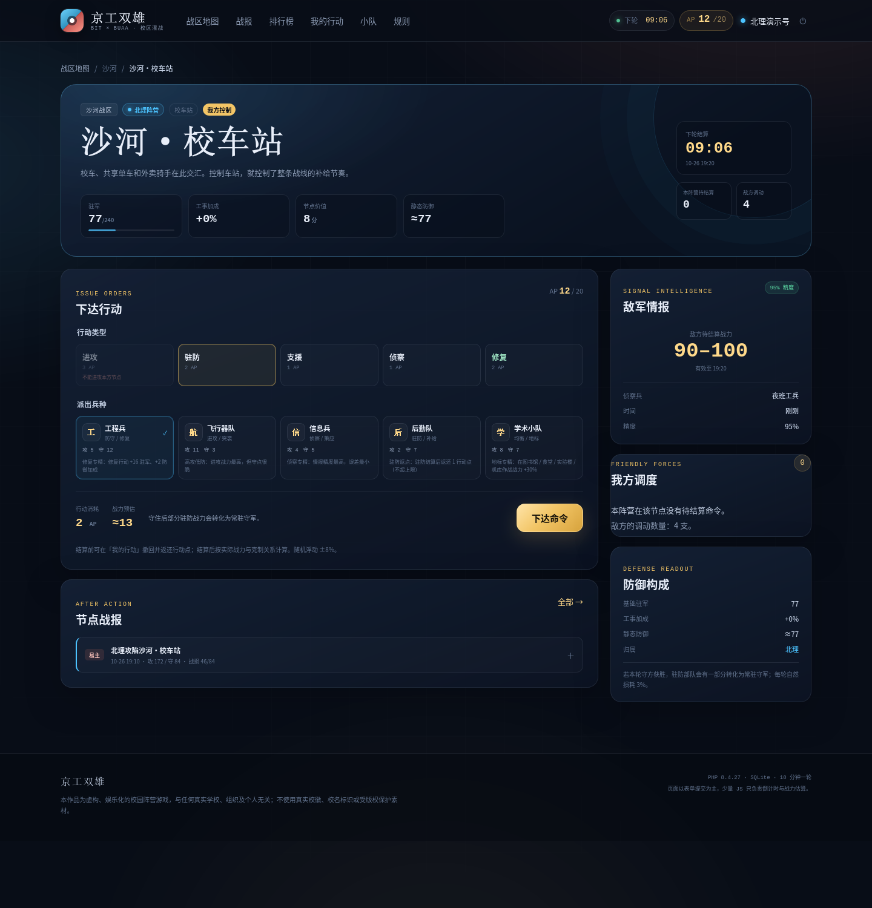

# 京工双雄：校区混战

> 北理 vs 北航 · 异步占点战
>
> 一个用 **PHP + SQLite + HTML/CSS + 少量 JS** 实现的网页游戏：加入阵营，用每日行动点争夺校区节点，PHP 每 10 分钟统一结算战报，一周后按占领度与贡献决出「京工双雄」。

本项目是基于原始构思直接落地的可运行版本，无 WebSocket、无实时长连接、无前端框架。交互以表单 POST + 页面刷新为主，JS 只做倒计时和战力预估。

> 娱乐化虚构作品，与真实学校、组织、个人无关；不使用真实校徽或受版权保护素材。请勿使用真实校园账号密码注册。

---

## 快速开始

环境要求：PHP 8.1+，启用 `pdo_sqlite`、`mbstring`、`session`。无需 Composer、无需 Node、无需 MySQL。

```bash
# 1. 初始化 SQLite 数据库（会自动建表、创建当前赛季、写入 9 个节点）
php bin/init_db.php

# 2. 可选：灌入演示玩家、历史战报和下一轮待结算命令
php bin/demo_seed.php

# 3. 启动本地服务器
php -S 127.0.0.1:8099 -t public public/index.php
```

浏览器打开 <http://127.0.0.1:8099>。

### 界面预览






### 演示账号

运行 `php bin/demo_seed.php` 后可使用：

| 账号 | 密码 | 阵营 |
| --- | --- | --- |
| `北理演示号` | `demo12345` | 北理 |
| `北航演示号` | `demo12345` | 北航 |

也可以直接注册新账号。演示数据包含 12 个演示账号（含 2 个可登录演示号）、4 支小队、11 场历史战斗、14 条待结算命令和共享侦察情报。

### 重置

```bash
php bin/init_db.php --fresh      # 清空并重建数据库
php bin/demo_seed.php            # 可选，重新灌演示数据
```

数据库默认位于 `data/game.sqlite`。可用环境变量 `GAME_DB_PATH` 指向其它路径（测试/多实例有用）。

---

## 玩法一览

### 阵营

- **北理阵营**：工事加成，驻防行动战力 +10%，偏工程、防守。
- **北航阵营**：机动加成，进攻行动战力 +8%，偏突袭、进攻。
- 阵营下可创建/加入**小队**，小队贡献单独排行，不提供战力加成。

### 地图

9 个节点覆盖学院路、中关村、良乡、沙河四个片区：

| 节点 | 价值 | 类型 | 开局归属 |
| --- | ---: | --- | --- |
| 学院路·主楼广场 | 10 | 广场 | 北理 |
| 学院路·图书馆 | 12 | 图书馆 | 中立 |
| 学院路·校车站 | 8 | 校车站 | 中立 |
| 中关村·天桥枢纽 | 9 | 枢纽 | 中立 |
| 中关村·美食广场 | 10 | 食堂 | 中立 |
| 良乡·工程训练中心 | 11 | 实验楼 | 北理 |
| 良乡·南操场 | 7 | 操场 | 北理 |
| 沙河·飞行器机库 | 11 | 机库 | 北航 |
| 沙河·校车站 | 8 | 校车站 | 北航 |

每个节点有归属、驻军、驻军上限、工事加成、积分价值与战报历史。

### 兵种

| 兵种 | 攻 / 守 | 定位 | 特性 |
| --- | --- | --- | --- |
| 工程兵 | 5 / 12 | 防守、修复 | 修复 +16 驻军、+2 工事 |
| 飞行器队 | 11 / 3 | 进攻、突袭 | 进攻基础战力最高 |
| 信息兵 | 4 / 5 | 侦察、策应 | 侦察精度 95% |
| 后勤队 | 2 / 7 | 驻防、补给 | 驻防结算后返还 1 AP |
| 学术小队 | 8 / 7 | 均衡、地标 | 图书馆/食堂/实验楼/机库 +30% |

克制环（仅前三种）：**工程兵 → 飞行器队 → 信息兵 → 工程兵**。克制方进攻 ×1.2，被反制 ×0.8。

### 行动

| 行动 | AP | 条件 | 说明 |
| --- | ---: | --- | --- |
| 进攻 | 3 | 非本方节点 | 与同阵营玩家合力攻坚 |
| 驻防 | 2 | 本方节点 | 结算时转为防御战力，守住后部分留驻 |
| 支援 | 1 | 任意节点 | 本方节点计防，其它节点计攻；战力按 50% 计算 |
| 侦察 | 1 | 任意节点 | 立即获得敌方待结算战力区间，全阵营共享 |
| 修复 | 2 | 本方节点 + 工程兵 | 立即 +16 驻军、+2 工事 |

每轮结算前可以撤回待定命令并全额返还 AP。侦察/修复立即生效，不进入待结算队列。

### 结算

- 每 **10 分钟** 一轮。优先由 `cron` 运行 `php bin/settle.php`；没有 cron 时，任意页面访问也会检查并补跑（文件锁防止并发重复结算）。
- 同一节点上的所有命令放在一起结算：
  - 进攻方战力 = Σ行动战力 × 兵种克制 ×（1 + 人数补正）
  - 防守方战力 =（驻军 + Σ驻防/支援战力）×（1 + 工事加成）×（1 + 人数补正）
  - 进攻方严格大于防守方才夺点；持平守方获胜。
- 夺点后新驻军 = `40 + 剩余攻击力 × 0.45`，工事清零。
- 守方获胜时驻军保留一部分；所有节点驻军每轮自然损耗 3%。
- 人数少的一方获得最高 +15% 补正。
- 结算生成文字战报，记录参战单位、战力、克制、战损、夺点结果和一句氛围文案。

### 赛季

- 每周一 00:00（Asia/Shanghai）自动结算上一周，地图、驻军、贡献、行动点重置。
- 阵营积分 = 占领节点价值 + 夺点 ×5 + 胜场 ×2。
- 冠军阵营成员获得「第 N 赛季·冠军」；个人榜前列获得 MVP、沙河突袭者、良乡守门员、学院路情报官等称号。
- 赛季贡献清零，但总贡献、胜负场与历史称号保留。

---

## 技术结构

```text
public/
  index.php               # 前端控制器 / 路由 / 控制器逻辑
  assets/css/app.css      # 全部视觉样式（响应式）
  assets/js/app.js        # 倒计时 + 表单战力预估（无框架）
  assets/favicon.svg
  .htaccess               # Apache 前端控制器重写规则
src/
  bootstrap.php           # 时区、session、自动结算入口
  config.php              # 所有游戏数值、兵种、节点、文案
  database.php            # PDO/SQLite、建库与种子
  schema.sql              # 表结构
  auth.php                # 注册、登录、用户加载
  helpers.php             # 时间、阵营、克制、平衡等工具
  http.php                # 渲染、错误页、路由辅助
  game/
    state.php             # 每日 AP、tick 状态、节点查询、情报
    actions.php           # 进攻/驻防/支援/侦察/修复/撤回
    combat.php            # 文件锁、统一结算、战报生成、驻军损耗
    season.php            # 赛季切换、地图重置、称号
    ranking.php           # 阵营/个人/小队排行榜
  views/                  # PHP 模板（layout + 各页面）
bin/
  init_db.php             # 初始化 / --fresh
  demo_seed.php           # 演示数据
  settle.php              # cron: 到点结算 / --force
  season.php              # 查看赛季 / --finalize --yes
data/
  game.sqlite             # 运行时生成
  sessions/               # 本地 PHP session
```

### 数据表

`users`、`factions`、`seasons`、`teams`、`nodes`、`orders`、`battles`、`intel`、`tick_state`、`app_meta`。

- `orders` 保存每条行动的战力快照，结算时统一标记 resolved/void。
- `battles` 保存每场战斗的攻防战力、战损、夺点结果、战报全文。
- `intel` 保存侦察情报，按阵营共享，过期后仍展示但标记为过期。
- `tick_state` 是单行表，记录轮次与下次结算时间。

### 时间

- 所有数据库时间以 **UTC** 存储（`Y-m-d H:i:s`）。
- 页面展示统一转换为 **Asia/Shanghai**。
- 赛季按本地周一 00:00 切分。

### 部署为子目录

如果站点部署在 `https://example.com/game/`，设置环境变量：

```bash
APP_BASE=/game php -S ...
# 或在 FPM/Apache 环境中设置 APP_BASE=/game
```

程序会据此生成所有链接。Web 根目录指向 `public/`，更推荐用独立域名或子域名。`APP_BASE` 同时支持环境变量和 PHP-FPM 的 `fastcgi_param APP_BASE`。

Nginx 子路径部署示例（假设项目在 `/var/www/example/game`，访问 `/game/`）：

```nginx
location = /game { return 301 /game/; }

# 前端控制器：显式指定脚本，并传入子路径
location = /game/index.php {
    include fastcgi_params;
    fastcgi_pass unix:/run/php/php8.4-fpm.sock;
    fastcgi_param SCRIPT_FILENAME /var/www/example/game/public/index.php;
    fastcgi_param DOCUMENT_ROOT /var/www/example/game/public;
    fastcgi_param APP_BASE /game;
    fastcgi_read_timeout 60s;
}

# 只允许 index.php 执行，防止其它 PHP 被直接访问
location ~ ^/game/(?!index\.php$).*\.php$ { deny all; }

# 必须用 ^~，避免被全局的静态资源正则抢走
location ^~ /game/assets/ {
    alias /var/www/example/game/public/assets/;
    expires 7d;
    access_log off;
}

location /game/ {
    alias /var/www/example/game/public/;
    index index.php;
    try_files $uri $uri/ /game/index.php?$query_string;
}
```

子域名部署（如 `game.example.com`）更简单，`root` 直接指向 `public/`，不需要 `APP_BASE`。

Apache 部署时把 `DocumentRoot` 指向 `public/`，并允许 `.htaccess` 重写（`AllowOverride All`）；`public/.htaccess` 已包含前端控制器规则。Nginx 可使用：

```nginx
root /path/to/bit_vs_bh/public;
index index.php;
location / {
    try_files $uri $uri/ /index.php?$query_string;
}
```

`data/` 与 `src/` 必须位于 Web 根目录之外。项目默认把 PHP session 写入 `data/sessions/`；如果该目录不可写，可用 `SESSION_SAVE_PATH` 指向其它可写目录。

### cron

```cron
*/10 * * * * cd /path/to/bit_vs_bh && php bin/settle.php >> data/settle.log 2>&1
```

不配置 cron 也能运行：玩家访问页面时会触发到点结算。配置 cron 后更准时，也能在没有访问时推进驻军损耗。

### 测试赛季结算

```bash
php bin/season.php                          # 查看当前赛季与积分
php bin/season.php --finalize --yes         # 强制结算并开启新赛季（会重置地图）
```

---

## 防刷与安全

- 密码使用 `password_hash()`（bcrypt），PDO 预处理语句防 SQL 注入。
- 所有 POST 表单带 CSRF Token；登录后 `session_regenerate_id()`。
- 登录失败 6 次进入 10 分钟冷却。
- 行动采用 PRG 模式，避免刷新重复提交。
- 每日 AP 上限、两次行动 15 秒冷却、最多 8 条待结算命令。
- 新玩家 24 小时内只能驻防/支援/侦察/修复。
- 结算使用文件锁 + SQLite 事务，避免重复结算。
- 输出统一 `e()` 转义，战报为纯文本按段落渲染。
- 演示账号仅供本地体验，公开部署前请删除演示账号或修改密码。

## 可调参数

绝大多数数值都在 `src/config.php`：

- `TICK_MINUTES`、`AP_MAX`、`AP_DAILY`
- `NEW_PLAYER_HOURS`、`ACTION_INTERVAL_SECONDS`、`MAX_PENDING_ORDERS`
- `SEASON_DAYS`、`GARRISON_DECAY_PCT`、`FORTIFY_CAP`
- `FACTIONS`、`UNITS`、`UNIT_COUNTERS`、`ACTIONS`、`NODE_SEED`

修改节点配置后，新赛季重置会套用新配置；已有节点不会自动迁移。开发期可直接 `php bin/init_db.php --fresh`。

---

## 免责声明

本项目是虚构、娱乐化的校园阵营游戏，与任何真实学校、组织及个人无关。游戏中的阵营名称、战报、称号与数值均为创作内容，不代表任何真实立场。请勿把游戏内的对抗代入现实，也不要使用真实校园账号密码注册。
