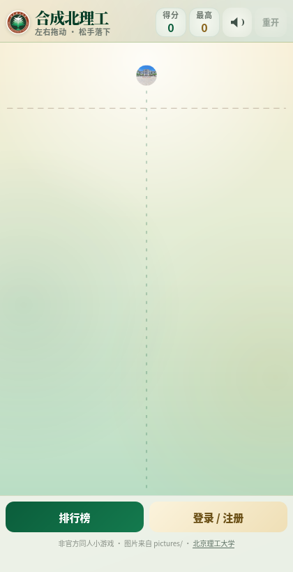
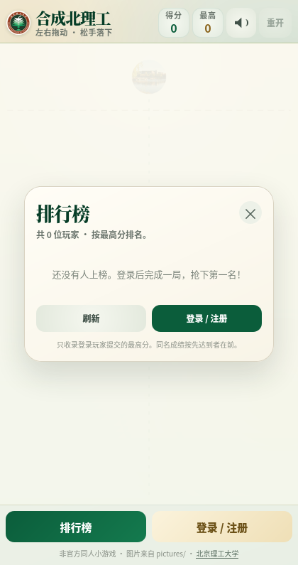
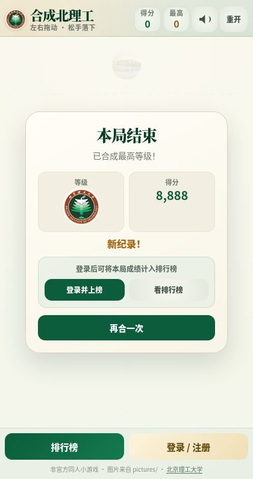

# 合成北理工 · 校园图片版

以 [GreatUSTC](https://github.com/feixukeji/GreatUSTC) 的合成玩法为框架制作的北理工主题小游戏：
拖动图片、松手落下，两个相同的图片合成更高一级，最高一级是 `xiao_hui.jpg` 校徽。

**当前为本地开发版**：不部署到远程服务器，游戏、PHP 接口和 `player.db` 都在本机运行。



排行榜（登录后参与）：



最高级结算：



## 关卡图片

前 8 级来自工作区 `pictures/` 里的校园照片（当前位于 `GreatBIT/` 的上一级），最高一级使用 `pictures/xiao_hui.jpg`：

| 等级 | 原图 | 游戏素材 |
| --- | --- | --- |
| 1 | `pictures/1.jpg` | `assets/levels/level-1.jpg` |
| 2 | `pictures/2.jpeg` | `assets/levels/level-2.jpg` |
| 3 | `pictures/3.jpg` | `assets/levels/level-3.jpg` |
| 4 | `pictures/4.jpg` | `assets/levels/level-4.jpg` |
| 5 | `pictures/5.jpg` | `assets/levels/level-5.jpg` |
| 6 | `pictures/6.jpg` | `assets/levels/level-6.jpg` |
| 7 | `pictures/7.jpg` | `assets/levels/level-7.jpg` |
| 8 | `pictures/8.png` | `assets/levels/level-8.jpg` |
| 9（最高） | `pictures/xiao_hui.jpg` | `assets/levels/xiao_hui.jpg` |

素材已经统一裁成 `512×512` 方形，运行时由 canvas 裁成圆形显示。
页眉图标和 favicon 使用 `assets/xiao_hui-logo.png`（由 `xiao_hui.jpg` 生成）。

## 本地运行

在 `GreatBIT/` 目录内：

```bash
php -S 127.0.0.1:8099 -t .
```

然后打开 <http://127.0.0.1:8099/>。

如果希望同一局域网内的手机 / 其他电脑访问，把监听地址改成：

```bash
php -S 0.0.0.0:8099 -t .
```

再用本机局域网 IP 访问，例如 `http://10.194.196.103:8099/`。

### 这台开发机的 SQLite 扩展

本机 PHP 默认没有 `pdo_sqlite`，但 `WEB_ROOT/PHP/vendor/php-ext/` 中带了 PHP 8.4 的扩展。
当前项目位于 `WEB_ROOT/GreatUSTC/GreatBIT`，可以这样启动：

```bash
cd GreatBIT
php \
  -d extension=../../PHP/vendor/php-ext/usr/lib/php/20240924/pdo_sqlite.so \
  -d extension=../../PHP/vendor/php-ext/usr/lib/php/20240924/sqlite3.so \
  -S 127.0.0.1:8099 -t .
```

没有 SQLite 扩展也能运行：程序会自动改用同名的 JSON 数据库。

### 初始化数据库

首次写入会自动创建 `data/player.db`；也可以手动初始化：

```bash
php server/init-db.php
```

## 功能

- 纯 HTML / CSS / JavaScript 游戏，无构建步骤。
- 9 级图片合成，最高级为 `xiao_hui` 校徽。
- 登录 / 注册后参与排行榜；未登录也能正常玩，只是不上榜。
- 排行榜显示排名、昵称、最高分、最高等级、达到日期、游玩局数。
- 结算时自动提交；未登录时可以先玩，结算后登录补交。
- 密码使用 `password_hash()`（bcrypt），登录态为 HttpOnly + SameSite=Lax Cookie。
- 服务端一次性 `runId`、最短 10 秒、分数/时长上限、重复提交拦截和限流。
- 数据库优先 SQLite；没有 `pdo_sqlite` 时自动退化为同文件 JSON 数据库。
- 手机 / 桌面自适应；支持 `#leaderboard`、`#login`、`#register` 深链接。

## 目录结构

```text
GreatBIT/
├── index.html              游戏页面（含登录 / 排行榜弹窗）
├── style.css               北理工绿 + 金色主题
├── game-config.js          9 个等级、图片路径、标题配置
├── game.js                 合成游戏引擎（基于 GreatUSTC）
├── leaderboard.js          登录、排行榜、成绩提交前端
├── api.php                 本地 PHP 接口入口
├── assets/
│   ├── levels/             9 张 512×512 关卡图片
│   └── xiao_hui-logo.png   页眉 / favicon 图标
├── data/
│   ├── player.db           排行榜数据库（SQLite 或 JSON）
│   ├── player.lock         文件锁
│   ├── .htaccess           Apache 下拒绝访问
│   └── index.html          目录占位
├── server/
│   ├── config.php          常量与配置
│   ├── storage.php         SQLite / JSON 存储层
│   ├── app.php             注册、登录、开局、提交、排行榜 API
│   └── init-db.php         初始化 player.db
├── docs/                   README 预览图
├── LICENSE                 AGPL-3.0（继承自 GreatUSTC）
└── README.md
```

## 排行榜规则

- 只有登录玩家提交的成绩会进入排行榜。
- 每局开始时调用 `action=start`，服务端生成一次性 `runId`（6 小时有效）。
- 提交时校验：
  - `runId` 存在、未使用、未过期；
  - 游戏时长至少 10 秒；
  - 分数不超过 `5000 + 游戏秒数 × 4000`（上限 1000 万）；
  - 客户端时长与服务端时长不能相差超过 120 秒；
  - 同一局只能提交一次。
- 每个玩家只保留最高分；同分时先达到者排前面。
- 登录失败按「IP + 用户名」限流（10 分钟 8 次），注册与开局也有宽松限制。

这是休闲小游戏级别的防作弊：服务端无法完全证明客户端分数真实，但能挡住重复提交、
超短时间和明显异常的大分数。

## 数据库 `data/player.db`

### 格式

- 默认创建 **SQLite** 数据库（文件头 `SQLite format 3`）。
- 如果主机没有 `pdo_sqlite`，首次创建时会写成 **JSON 文档数据库**，文件名仍然是 `player.db`。
- 程序通过文件头自动识别格式，两种格式对外 API 完全一致。

数据表：

| 表 | 用途 |
| --- | --- |
| `players` | 玩家账号、密码哈希、最高分、最高等级、局数 |
| `sessions` | 登录令牌哈希与过期时间（30 天） |
| `runs` | 每局的一次性排行会话，防重复提交 |
| `attempts` | 登录 / 注册限流记录 |
| `meta` | 下一个玩家 ID、创建时间、schema 版本 |

### 备份 / 重置

SQLite：

```bash
sqlite3 data/player.db ".backup 'player-backup.db'"
```

JSON 格式直接复制 `data/player.db`。

重置排行榜：

```bash
# 先备份！
rm -f data/player.db data/player.db-wal data/player.db-shm data/player.lock
php server/init-db.php
```

## API

所有接口返回：

```json
{"ok":true,"data":{...}}
{"ok":false,"error":{"code":"...","message":"..."}}
```

| 方法 | 地址 | 说明 |
| --- | --- | --- |
| GET | `api.php?action=ping` | 探活，返回数据库格式 |
| GET | `api.php?action=me` | 当前登录玩家，未登录时 `player: null` |
| GET | `api.php?action=leaderboard&limit=50` | 排行榜 |
| POST | `api.php?action=register` | `{"username":"...","password":"..."}` |
| POST | `api.php?action=login` | `{"username":"...","password":"..."}` |
| POST | `api.php?action=logout` | 退出登录 |
| POST | `api.php?action=start` | 开始一局，返回 `runId` |
| POST | `api.php?action=submit` | 提交成绩 |

`submit` 示例：

```json
{
  "runId": "32 位十六进制字符串",
  "score": 4321,
  "maxLevel": 8,
  "durationMs": 65000,
  "highestMerged": false
}
```

`maxLevel` 是 0 起始的等级下标，`8` 表示最高级 `xiao_hui`。

错误码：`INVALID_INPUT`、`INVALID_CREDENTIALS`、`USERNAME_TAKEN`、`RATE_LIMITED`、
`AUTH_REQUIRED`、`RUN_NOT_FOUND`、`RUN_USED`、`RUN_EXPIRED`、`TOO_FAST`、
`SCORE_REJECTED`、`DB_UNAVAILABLE`。

## 换图片 / 改难度

编辑 `game-config.js`：

```js
assetBase: "assets/levels/",
spawnLevelCount: 5,
levels: [
  { radius: 14, image: "level-1.jpg" },
  // ...
  { radius: 88, image: "xiao_hui.jpg" }
]
```

- `radius` 必须严格递增，范围 6–199。
- `image` 相对于 `assetBase`，支持 JPG / PNG / WebP / SVG。
- 想换素材：把新图片裁成正方形，放到 `assets/levels/`，再改对应文件名。
- 页眉图标：替换 `assets/xiao_hui-logo.png`。

## 常见问题

**排行榜显示“服务未启用 / 加载失败”？**

- 确认是通过 PHP 内置服务器打开，而不是直接双击 `index.html`（`file://` 下没有接口）。
- 打开 `api.php?action=ping` 应返回 JSON。
- 静态托管（GitHub Pages、纯静态 nginx）无法执行 PHP，不能用排行榜。

**登录后成绩没有上榜？**

- 每局至少 10 秒才能提交；太短的局会被拒绝。
- 检查结算面板是否显示「已上榜 · 第 N 名」。
- 如果提示「本局排行会话已失效」，重新开一局即可。

**为什么 `player.db` 是 JSON 而不是 SQLite？**

当前 PHP 没有启用 `pdo_sqlite`，程序自动降级了。启用扩展后删除旧的
`player.db` 再初始化，即可使用 SQLite。两种格式功能一致。

## 说明

- 本项目是非官方同人小游戏，与北京理工大学无隶属关系。
- 校园照片和校徽来自工作区的 `pictures/`，版权归原作者 / 学校所有，仅作非商业的本地娱乐。
- 游戏框架来自 [feixukeji/GreatUSTC](https://github.com/feixukeji/GreatUSTC)，遵循 AGPL-3.0。
