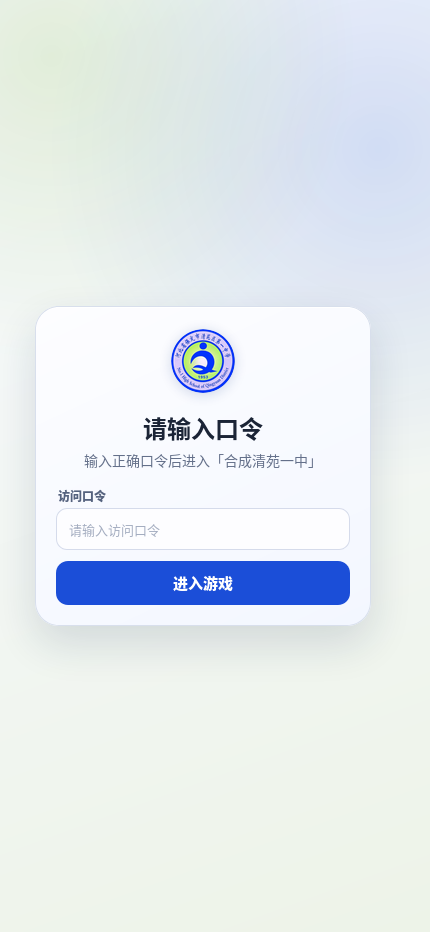
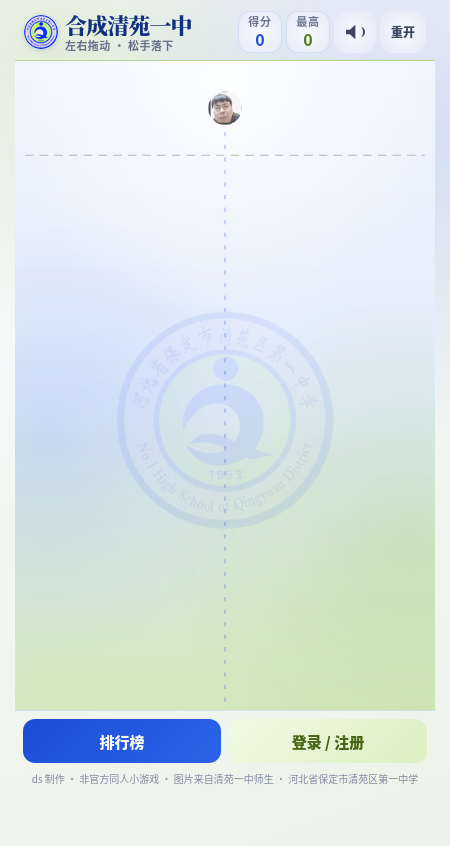
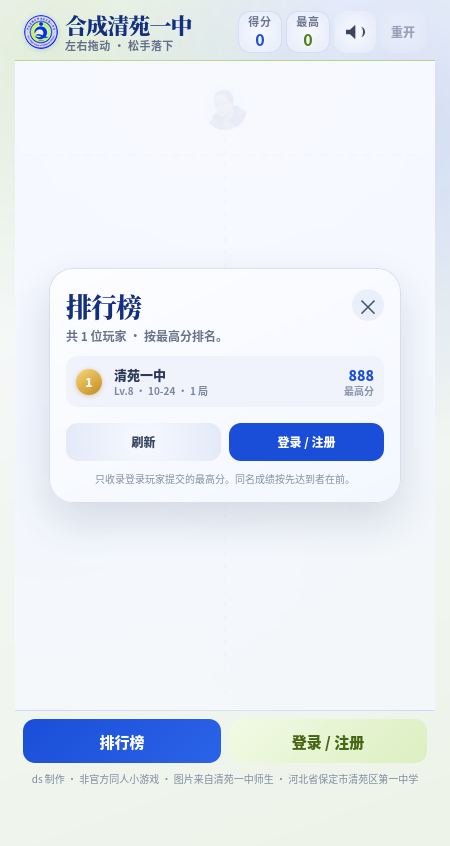
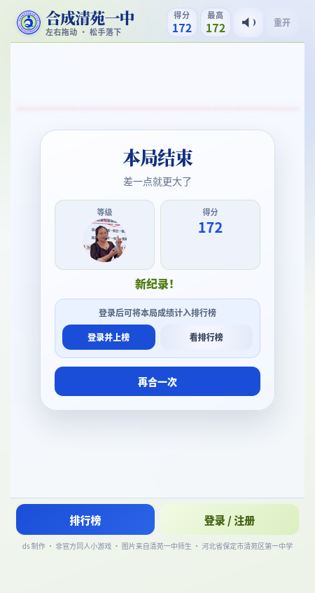

# 合成清苑一中 · 校园图片版

以 [GreatUSTC](https://github.com/feixukeji/GreatUSTC) 的合成玩法为框架、
按照 `create_bit/` 的工程结构重构的清苑一中主题小游戏：
左右拖动图片、松手落下，两个相同的图片合成更高一级，共 17 级。

> 原单文件版本（ds 制作）已备份到工作区的 `create_qyyz.bak/`。
> 新版把游戏、主题样式、排行榜前端 / 后端拆成与 `create_bit/` 一致的目录结构。

## 页面预览

访问口令页：



首页：



排行榜（登录后参与）：



结算：



## 关卡图片

17 级全部来自原版 `1.jpg`–`17.jpg`，统一裁成 `512×512` 方形素材后放入
`assets/levels/`，运行时由 canvas 裁成圆形显示：

| 等级 | 原图 | 游戏素材 | 半径 |
| --- | --- | --- | --- |
| 1 | `1.jpg` | `assets/levels/level-1.jpg` | 14 |
| 2 | `2.jpg` | `assets/levels/level-2.jpg` | 16 |
| 3 | `3.jpg` | `assets/levels/level-3.jpg` | 18 |
| 4 | `4.jpg` | `assets/levels/level-4.jpg` | 21 |
| 5 | `5.jpg` | `assets/levels/level-5.jpg` | 24 |
| 6 | `6.jpg` | `assets/levels/level-6.jpg` | 28 |
| 7 | `7.jpg` | `assets/levels/level-7.jpg` | 32 |
| 8 | `8.jpg` | `assets/levels/level-8.jpg` | 37 |
| 9 | `9.jpg` | `assets/levels/level-9.jpg` | 43 |
| 10 | `10.jpg` | `assets/levels/level-10.jpg` | 49 |
| 11 | `11.jpg` | `assets/levels/level-11.jpg` | 56 |
| 12 | `12.jpg` | `assets/levels/level-12.jpg` | 65 |
| 13 | `13.jpg` | `assets/levels/level-13.jpg` | 74 |
| 14 | `14.jpg` | `assets/levels/level-14.jpg` | 86 |
| 15 | `15.jpg` | `assets/levels/level-15.jpg` | 98 |
| 16 | `16.jpg` | `assets/levels/level-16.jpg` | 113 |
| 17（最高） | `17.jpg` | `assets/levels/level-17.jpg` | 130 |

原版中的 `4.5.jpg` 不在 1–17 的升级序列里，因此未使用。
校徽 `bg.jpg` 被处理成圆形透明图标，用作页眉、favicon：`assets/logo.png`。

## 本地运行

在 `create_qyyz/` 目录内启动 PHP 内置服务器：

```bash
php -S 127.0.0.1:8099 -t .
```

然后打开 <http://127.0.0.1:8099/>。

也可以用：

```bash
make serve       # 等价于 php -S 127.0.0.1:8099 -t .
make init-db     # 初始化 data/player.db
```

如果希望同一局域网内的手机 / 其他电脑访问，把监听地址改成：

```bash
php -S 0.0.0.0:8099 -t .
```

再用本机局域网 IP 访问，例如 `http://10.194.196.103:8099/`。

### 访问口令

首次打开会先显示口令页，输入正确口令后才会输出游戏页面。

- 默认口令：`qyyz1953`
- 修改位置：[index.php](index.php) 顶部的 `QYYZ_GATE_PASSCODE`
- 口令 Cookie 默认 30 天有效；修改口令后旧 Cookie 会自动失效
- 口令页必须由 PHP 执行；纯静态托管无法使用，也可能把 PHP 源码暴露出去

部署提示：`index.html` 只负责跳转到 `index.php`，本身不含游戏代码。
如果服务器上还留着旧版 `index.html`，而目录默认首页又优先 `index.html`，
访问 `/create_qyyz/` 会直接打开旧游戏而不是口令页。遇到这种情况：

- 删除服务器上的旧 `index.html`，或上传新的跳转版 `index.html`
- Apache：`.htaccess` 已设置 `DirectoryIndex index.php index.html`
- nginx：在站点配置里设置 `index index.php index.html;`

这个口令只保护入口页面，不保护 `game.js`、图片和排行榜 API 等静态资源。
需要连静态资源一起保护时，请使用 nginx Basic Auth 或服务端统一鉴权。

### SQLite

本项目优先使用 SQLite。当前 PHP 启用了 `pdo_sqlite` 时，`data/player.db`
是标准 SQLite 文件；如果主机没有该扩展，程序会自动改用同名的 JSON 文件数据库。
两种格式对外 API 完全一致。

### 初始化数据库

首次写入会自动创建 `data/player.db`；也可以手动初始化：

```bash
php server/init-db.php
```

## 功能

- PHP 口令入口 + 纯 HTML / CSS / JavaScript 游戏，无构建步骤。
- 17 级图片合成，使用清苑一中主题的蓝 + 绿配色和校徽图标。
- 首次进入需要输入口令，口令写在 `index.php` 中，可用 Cookie 保持 30 天。
- 登录 / 注册后参与排行榜；未登录也能正常玩，只是不上榜。
- 排行榜显示排名、昵称、最高分、最高等级、达到日期、游玩局数。
- 结算时自动提交；未登录时可以先玩，结算后登录补交。
- 密码使用 `password_hash()`（bcrypt），登录态为 HttpOnly + SameSite=Lax Cookie。
- 服务端一次性 `runId`、最短 10 秒、分数 / 时长上限、重复提交拦截和限流。
- 数据库优先 SQLite；没有 `pdo_sqlite` 时自动退化为同文件 JSON 数据库。
- 手机 / 桌面自适应；支持 `#leaderboard`、`#login`、`#register` 深链接。

## 目录结构

```text
create_qyyz/
├── index.html              旧链接跳转（只跳转到 index.php）
├── index.php               口令入口 + 游戏页面（含登录 / 排行榜弹窗）
├── style.css               清苑一中蓝绿主题
├── game-config.js          17 个等级、图片路径、标题配置
├── game.js                 合成游戏引擎（基于 GreatUSTC）
├── leaderboard.js          登录、排行榜、成绩提交前端
├── api.php                 本地 PHP 接口入口
├── Makefile                serve / init-db 快捷命令
├── assets/
│   ├── levels/             17 张 512×512 关卡图片
│   └── logo.png            校徽页眉 / favicon 图标
├── data/
│   ├── player.db           排行榜数据库（运行时数据，线上建议外置）
│   ├── player.lock         文件锁
│   ├── .htaccess           Apache 下拒绝访问
│   └── index.html          目录占位
├── server/
│   ├── config.php          常量与配置
│   ├── storage.php         SQLite / JSON 存储层
│   ├── app.php             注册、登录、开局、提交、排行榜 API
│   └── init-db.php         初始化 player.db
├── docs/                   README 预览图
├── LICENSE                 AGPL-3.0（继承自 GreatUSTC）
└── README.md
```

## 排行榜规则

- 只有登录玩家提交的成绩会进入排行榜。
- 每局开始时调用 `action=start`，服务端生成一次性 `runId`（6 小时有效）。
- 提交时校验：
  - `runId` 存在、未使用、未过期；
  - 游戏时长至少 10 秒；
  - 分数不超过 `5000 + 游戏秒数 × 4000`（上限 1000 万）；
  - 客户端时长与服务端时长不能相差超过 120 秒；
  - 同一局只能提交一次；
  - `maxLevel` 在 0–16 之间。
- 每个玩家只保留最高分；同分时先达到者排前面。
- 登录失败按「IP + 用户名」限流（10 分钟 8 次），注册与开局也有宽松限制。

这是休闲小游戏级别的防作弊：服务端无法完全证明客户端分数真实，但能挡住重复提交、
超短时间和明显异常的大分数。

## 数据库（默认 `data/player.db`）

默认路径是 `data/player.db`，也可以通过 `QYYZ_DATA_DIR` 指向部署目录之外。

### 格式

- 默认创建 **SQLite** 数据库（文件头 `SQLite format 3`）。
- 如果主机没有 `pdo_sqlite`，首次创建时会写成 **JSON 文档数据库**，文件名仍然是 `player.db`。
- 程序通过文件头自动识别格式，两种格式对外 API 完全一致。

数据表：

| 表 | 用途 |
| --- | --- |
| `players` | 玩家账号、密码哈希、最高分、最高等级、局数 |
| `sessions` | 登录令牌哈希与过期时间（30 天） |
| `runs` | 每局的一次性排行会话，防重复提交 |
| `attempts` | 登录 / 注册限流记录 |
| `meta` | 下一个玩家 ID、创建时间、schema 版本 |

### 部署时为什么数据库会被清空（重要）

`data/player.db` 是运行时数据，但它现在仍被 Git 跟踪，而且位于代码目录里。
更新代码时以下操作都会覆盖或删除它：

- `git pull` / `git reset --hard`：用仓库里的 `player.db` 覆盖线上库
- `git clean -fdx` / `rsync --delete` / 整目录发布：直接删除或替换
- 重新 clone / 新 release 目录：新目录里只有仓库版的空库

因此排行榜数据不能放在会被部署覆盖的目录里。推荐把它移到部署目录之外，
例如 `/var/www/guosyzamz.top/shared/create_qyyz/data`：

```bash
mkdir -p /var/www/guosyzamz.top/shared/create_qyyz/data

# SQLite 用 .backup，避免复制到 WAL 中的未落盘数据
sqlite3 /var/www/guosyzamz.top/content/create_qyyz/data/player.db \
  ".backup '/var/www/guosyzamz.top/shared/create_qyyz/data/player.db'"

# 如果是 JSON 格式，直接 cp 即可
# cp /var/www/.../content/create_qyyz/data/player.db /var/www/.../shared/create_qyyz/data/

chown -R www-data:www-data /var/www/guosyzamz.top/shared/create_qyyz
chmod 700 /var/www/guosyzamz.top/shared/create_qyyz/data
chmod 600 /var/www/guosyzamz.top/shared/create_qyyz/data/player.db
```

在 nginx 的 `index.php` 和 `api.php` 两个 PHP location 里加：

```nginx
fastcgi_param QYYZ_DATA_DIR /var/www/guosyzamz.top/shared/create_qyyz/data;
```

重载并验证：

```bash
nginx -t && systemctl reload nginx
curl -s "https://www.guosyzamz.top/content/create_qyyz/api.php?action=ping"
curl -s "https://www.guosyzamz.top/content/create_qyyz/api.php?action=leaderboard"
ls -la /var/www/guosyzamz.top/shared/create_qyyz/data/
```

确认线上已经使用外部目录后，再停止跟踪仓库里的运行库：

```bash
cd /home/guosh/GIT/WEB_ROOT
git rm --cached create_qyyz/data/player.db
git commit -m "Stop tracking runtime leaderboard database"
git push
```

`create_qyyz/.gitignore` 已经加入 `data/player.db`；但在执行 `git rm --cached`
之前，Git 仍会跟踪它，忽略规则不会生效。

> 首次拉取“取消跟踪”的提交时，服务器上的旧 `data/player.db` 会被删除。
> 务必先完成上面的迁移，并确认外部库可读写，再推送这个提交。

如果暂时不能外置，至少保证部署脚本不删除、不覆盖 `data/player.db`，
并且每次发布前先备份。

### 备份 / 重置

SQLite：

```bash
sqlite3 data/player.db ".backup 'player-backup.db'"
```

JSON 格式直接复制 `data/player.db`。

重置排行榜：

```bash
# 先备份！
rm -f data/player.db data/player.db-wal data/player.db-shm data/player.lock
php server/init-db.php
```

如果设置了 `QYYZ_DATA_DIR`，请把上面命令里的 `data/player.db` 换成实际路径。

## API

所有接口返回：

```json
{"ok":true,"data":{...}}
{"ok":false,"error":{"code":"...","message":"..."}}
```

| 方法 | 地址 | 说明 |
| --- | --- | --- |
| GET | `api.php?action=ping` | 探活，返回数据库格式 |
| GET | `api.php?action=me` | 当前登录玩家，未登录时 `player: null` |
| GET | `api.php?action=leaderboard&limit=50` | 排行榜 |
| POST | `api.php?action=register` | `{"username":"...","password":"..."}` |
| POST | `api.php?action=login` | `{"username":"...","password":"..."}` |
| POST | `api.php?action=logout` | 退出登录 |
| POST | `api.php?action=start` | 开始一局，返回 `runId` |
| POST | `api.php?action=submit` | 提交成绩 |

`submit` 示例：

```json
{
  "runId": "32 位十六进制字符串",
  "score": 4321,
  "maxLevel": 8,
  "durationMs": 65000,
  "highestMerged": false
}
```

`maxLevel` 是 0 起始的等级下标，`16` 表示最高级。

错误码：`INVALID_INPUT`、`INVALID_CREDENTIALS`、`USERNAME_TAKEN`、`RATE_LIMITED`、
`AUTH_REQUIRED`、`RUN_NOT_FOUND`、`RUN_USED`、`RUN_EXPIRED`、`TOO_FAST`、
`SCORE_REJECTED`、`DB_UNAVAILABLE`。

## 换图片 / 改难度

编辑 `game-config.js`：

```js
assetBase: "assets/levels/",
spawnLevelCount: 5,
levels: [
  { radius: 14, image: "level-1.jpg" },
  // ...
  { radius: 130, image: "level-17.jpg" }
]
```

- `radius` 必须严格递增，范围 6–199（画板宽 400，半径不能超过一半）。
- `image` 相对于 `assetBase`，支持 JPG / PNG / WebP / SVG。
- 想换素材：把新图片裁成正方形，放到 `assets/levels/`，再改对应文件名。
- 页眉 / favicon 图标：替换 `assets/logo.png`。
- 初始只掉落前 `spawnLevelCount` 级（默认前 5 级）。

## 常见问题

**打开页面只看到口令输入框？**

- 这是正常的入口口令页。默认口令为 `qyyz1953`，也可以在 `index.php` 顶部修改。
- 确认服务器启用了 PHP；纯静态托管不会执行 `index.php`。

**排行榜显示“服务未启用 / 加载失败”？**

- 确认是通过 PHP 内置服务器打开，而不是直接双击 `index.php`（`file://` 下没有接口）。
- 打开 `api.php?action=ping` 应返回 JSON。
- 静态托管（GitHub Pages、纯静态 nginx）无法执行 PHP，不能用口令页和排行榜。

**登录后成绩没有上榜？**

- 每局至少 10 秒才能提交；太短的局会被拒绝。
- 检查结算面板是否显示「已上榜 · 第 N 名」。
- 如果提示「本局排行会话已失效」，重新开一局即可。

**为什么每次更新后排行榜数据清空？**

`data/player.db` 被 Git 跟踪，又位于部署目录里，`git pull`、`git reset --hard`、
`git clean -fdx` 或整目录发布都会覆盖/删除它。请按
「[部署时为什么数据库会被清空](#部署时为什么数据库会被清空重要)」把数据目录移到
`QYYZ_DATA_DIR` 指向的部署目录之外。

**为什么 `player.db` 是 JSON 而不是 SQLite？**

当前 PHP 没有启用 `pdo_sqlite`，程序自动降级了。启用扩展后删除旧的
`player.db` 再初始化，即可使用 SQLite。两种格式功能一致。

## 说明

- 本项目是非官方同人小游戏，与清苑区第一中学无隶属关系。
- 口令是简单的页面级访问控制，不构成对静态资源的版权或访问保护。
- 图片来自原版 `create_qyyz` 素材，版权归原作者 / 学校所有，仅作非商业的本地娱乐。
- 游戏框架来自 [feixukeji/GreatUSTC](https://github.com/feixukeji/GreatUSTC)，
  并通过 `create_bit/` 的工程结构移植，遵循 AGPL-3.0。
